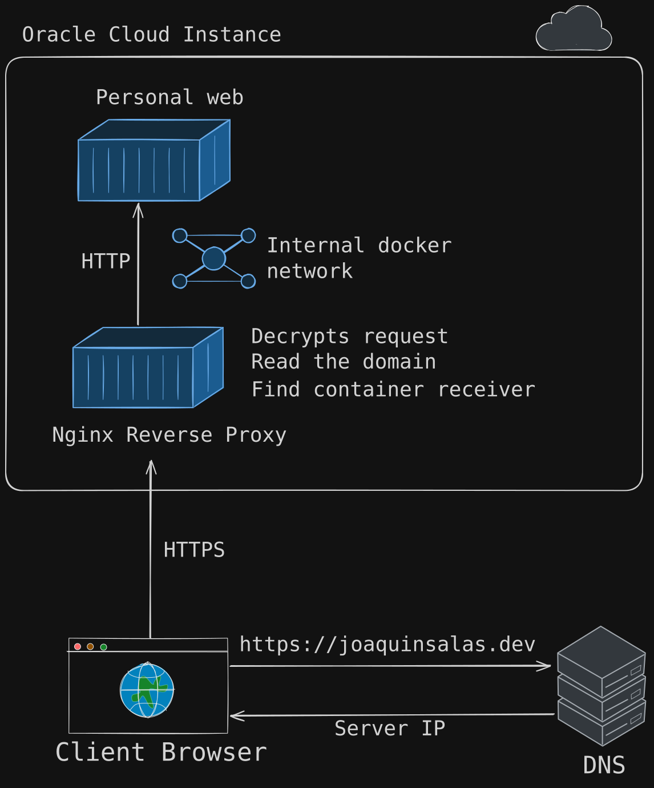
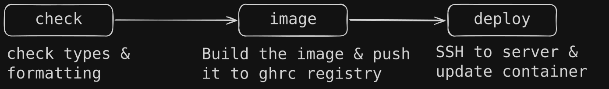

This project is this website itself!

I had been planning to build my own website for a while. My idea was to have a site that acts as a kind of portfolio and where I post about technologies and things I'm learning.

This way, I have a real website deployed on the internet so that anyone can reach it and I learn how to do it in the process: what technologies will I use? How can I deploy it? How do I buy a domain? How do I use a reverse proxy? How do I deploy to production with GitHub Actions?

## Astro

### Why Astro

In web development, I have experience working with **React** for the frontend and **Node.js** for the backend, so these technologies were the first things that came to mind, but they have a problem.

These technologies are meant to be used for highly interactive pages and they send a lot of JavaScript code to the browser, which can make them slow for the user. In addition, this website doesn't need to call any API, so no backend is required.

This website is mainly focused on content, and a framework that fits this perfectly is [Astro](https://astro.build/).

It is designed for static websites like blogs, marketing sites and e-commerce sites. It renders the content on the server (SSR) or at build time (SSG) and sends the HTML files to the client, which makes it a lot faster. Furthermore, you can add interactivity with **Islands**, which are small isolated components that can use React, Preact, Vue, Svelte, etc.

### How Astro works

Since Astro is a **framework**, you must adapt the code to its structure and conventions and in return it does the repetitive work. This is called _inversion of control_: the framework calls your code.

For example, it handles routing and generates URLs from your folder structure. This means that some folders are strictly required, such as `src/pages`. If this folder doesn't exist, it can't find the website pages and the result is a site with no pages.

Astro uses **Content Collections** to manage sets of related, structurally identical data that you can retrieve. An **entry** is a member of one collection with real content and metadata on it. Furthermore, you can define a **schema** to validate the shape of a collection.

This concept is very similar to OOP where you define a class that is a state template and you can instantiate it with actual data on it and have a list of instances.

Astro uses `.astro` files. Each file has two parts: a frontmatter, written in JavaScript or TypeScript between two \- \- \- fences, and an HTML template below it. In a static site like this one, the frontmatter runs only at build time, so none of that code reaches the browser. What the browser receives is the HTML it generates.

A short example could be:

```astro
---
const articles = await getArticles(); // Runs at build time
---

<ul>
	{articles.map((article) => (
		<li>{article.data.title}</li>
	))}
</ul>
```

## Architecture

Before writing a single line of code, the best thing you can do is define the architecture: how to organise the files and what responsibility each part will have.

Nowadays this is more important than ever. Almost everyone uses AI agents, which are limited by their context windows. If you keep working in the same conversation for a long time, the agent is going to forget important parts of your project. As a result, when you want to add a new feature, the agent could break unrelated parts or write code that is already written. This is why _"vibe coding"_ can't be used for real projects.

For projects, I like to think about decoupled systems as much as I can. This time it is easy to think that the content can't be affected by how the site looks. The presentation layer only needs to fetch the right content and put it on the correct Astro layouts and components.

I've separated the responsibility in this way:


## Deployment

Up to this point, the website is only visible on localhost, so it's time to Dockerize the app and deploy it on a real server.

### Dockerization

Docker is used to isolate the app and its dependencies in a container. Thanks to this you can run the app on any machine and it just works.

To build the **image**, you need to write the `Dockerfile` with the website files and all dependencies.

First, it builds the website from the source code into static files in `dist/`.

```dockerfile
# Pull Node.js on Alpine Linux image
FROM --platform=$BUILDPLATFORM node:24-alpine AS build
WORKDIR /app
# Corepack installs the pnpm version pinned in package.json's "packageManager".
RUN corepack enable
# Copy dependencies first to optimise cache usage
COPY package.json pnpm-lock.yaml ./
RUN pnpm install --frozen-lockfile
# Copy the whole project and generate dist/
COPY . .
RUN pnpm build
```

At this point the website is dockerized, but the future container will hold all the dependencies and I only want the `dist/` folder.
Besides they are only files on a disk. How are the files going to be sent when a client makes a request? For this, you need an HTTP web server and in this case I'm using **Nginx**.

Therefore, the next stage of the `Dockerfile` is:

```dockerfile
# Pull a non-root nginx image to limit possible security breaches
FROM nginxinc/nginx-unprivileged:stable-alpine
# Copy the nginx configuration for this website into the image
COPY deploy/nginx.conf /etc/nginx/conf.d/default.conf
# Copy dist/ from the previous stage into nginx
COPY --from=build /app/dist /usr/share/nginx/html
EXPOSE 8080
```

Finally the Docker image with the app is complete.

### Server and reverse proxy

A few months ago I decided to create the **Oracle Cloud** free instance **Ampere A1**. Since then, I have used it to hold several services like music streaming with navidrome or making minecraft servers with crafty controller.

Furthermore, I installed [NGINX Reverse Proxy](https://hub.docker.com/r/nginxproxy/nginx-proxy). This container sits in front of the other services, receives every request from the internet through ports 80 and 443 and passes each connection to the right service. This way, only the typical `HTTP` and `HTTPS` ports are open to the internet and it holds the encryption certificates (from [Let's Encrypt](https://letsencrypt.org/)).

The last step is to buy the domain in [Porkbun](https://porkbun.com/) and register it into the reverse proxy.

So a request to the server looks like this:



### CI/CD with GitHub Actions

For Continuous Integration and Continuous Deployment I'm using GitHub Actions to automate code checking and deployment on the server.

Without this, every time I wanted to add new changes I would connect to the server, pull the latest repository version, run `pnpm check` and execute `docker compose up -d` manually.

The idea is to have a pipeline that executes when changes are merged into main and pushed to GitHub.



1. Run `pnpm check`.
2. Build the docker image and push it to the `ghcr.io` registry. It's important to mention that in this part the image is built for **x86** and **ARM**, because it's the server processor architecture.
3. Connect to the server via SSH, pull the image and run `docker compose up -d`.

## What I learned

- How **Astro** works and what it is for.
- What is **Tailwind CSS** and how to use it.
- How to build a CI/CD pipeline with **GitHub Actions**.
- How to buy a **domain** and publish a real **website** to **production**.
- How to **dockerize** an application.
