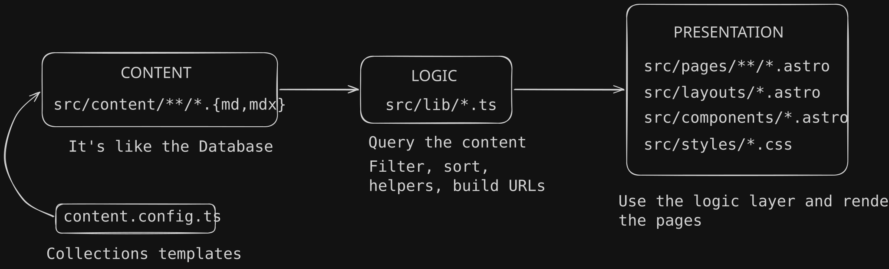

This project is this website itself!

I had been planning to build my own website for a while. My idea was to have a site that acts as a kind of portfolio and where I post about technologies and things I'm learning.

This way, I have a real website deployed on the internet so everyone can reach it and I learn how to do it in the process: What technologies will I use? How can I deploy it? How do I buy a domain? How do I use a reverse proxy? How do I deploy to production with GitHub Actions?

## Astro

### Why Astro

In web development, I have experience working with **React** for the frontend and **Node.js** for the backend, so these technologies were the first things that came to mind, but they have a problem.

These technologies are meant to be used for highly interactive pages and they send a lot of JavaScript code to the browser, which can make them slow for the user. In addition, this website doesn't need to call any API, so no backend is required.

This website is mainly focused on content and a framework that fits this perfectly is [Astro](https://astro.build/).

It is designed for static websites like blogs, marketing sites and e-commerce sites. It renders the content on the server (SSR) or at build time (SSG) and sends the HTML files to the client, which makes it a lot faster. Furthermore, you can add interactivity with **Islands**, which are small isolated components that can use React, Preact, Vue, Svelte, etc.

### How Astro works

Since Astro is a **framework**, you must adapt the code to its structure and conventions and in return it does the repetitive work. This is called _inversion of control_, the framework calls your code.

For example, it handles routing and generates URLs from your folder structure. This means that some folders are strictly required, such as `src/pages`. If this folder doesn't exists, it can't find the website pages and the result is a site with no pages.

Astro uses **Content Collections** to manage sets of related, structurally identical data that you can retrieve. An **entry** is a member of one collection with real content and metadata on it. Furthermore, you can define a **schema** to validate the shape of a collection.

This concept is very similar to OOP where you define a class that is a state template and you can instance it with actual data on it and have a list of instances.

Astro uses `.astro` files. Each file has two parts: a frontmatter, written in JavaScript or TypeScript between two \- \- \- fences, and an HTML template below it. In a static site like this one, the frontmatter runs only at build time, so none of that code reaches the browser. What the browser receives is the HTML it generates.

A short example could be:

```astro
---
const articles = await getArticles(); // Runs at build time
---

<ul>
	{articles.map((article) => (
		<li>{article.data.title}</li>
	))}
</ul>
```

## Architecture

Before writing a single line of code, the best thing you can do is define the architecture: how to organise the files and what responsibility will have each part.

Nowadays this is more important than ever. Almost everyone use AI agents, which are limited to its context windows. If you keep working on the same conversation for a long time, the agent is going to forget important parts of your project. This way, when you want to add a new feature, the agent could break things that aren't involved or write code that is already written. This is why _"vibe coding"_ can't be used for real projects.

For projects, I like to think about decoupled systems as much as I can. This time is easy to think that the content can't be affected by how the site looks. The presentation layer only needs to fetch the right content and put it on the correct Astro layouts and components.

I've separated the responsibility in this way:



## Deployment

Up to this point, the website is only visible on localhost, so it's time to Dockerize the app and deploy it on a real server.

### Dockerization

Docker is used to isolate in a container the app and its dependencies. Thanks to this you can execute the app on every machine and it just works.

For building the **image** it's necessary to write the `Dockerfile` with the website files and all dependencies.

First, it builds the website from the source code into static files in `dist/`.

```dockerfile
# Pull Alpine Linux image
FROM --platform=$BUILDPLATFORM node:24-alpine AS build
WORKDIR /app
# Corepack installs the pnpm version pinned in package.json's "packageManager".
RUN corepack enable
# Copy dependencies first to optimize cache usage
COPY package.json pnpm-lock.yaml ./
RUN pnpm install --frozen-lockfile
# Copy the whole project and generate dist/
COPY . .
RUN pnpm build
```

Now the website is dockerize, the files are in a container, but they are only files on a disk. How the files are going to be send when a client make a request? For this, it is use a HTTP web server and in this case I'm using **Nginx**.

Therefore, the next stage of the `Dockerfile` is:

```dockerfile
# Pull a non-root nginx image to limit possible security breaches
FROM nginxinc/nginx-unprivileged:stable-alpine
# Copy the nginx configuration for this website into the image
COPY deploy/nginx.conf /etc/nginx/conf.d/default.conf
# Copy dist/ from the previous stage into nginx
COPY --from=build /app/dist /usr/share/nginx/html
EXPOSE 8080
```

Finally the Docker image with the app is complete. Now to launch the container when the project arrives at the server it is required a `compose.yaml` file with the instructions for building the image and running the container:

```yaml

```

### CI/CD with GitHub Actions

### Server and reverse proxy

## How I used AI

## What I learned
